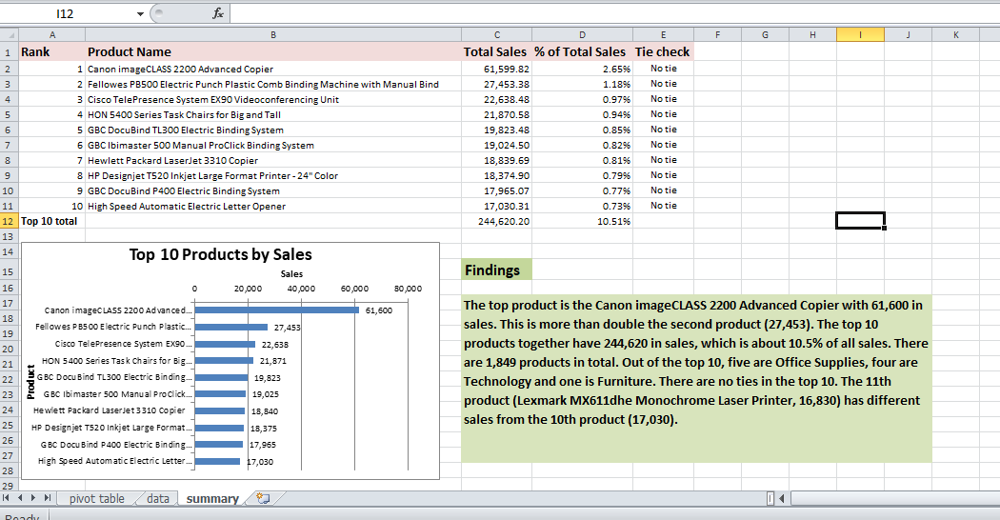

# Top 10 Products by Sales (Superstore Dataset)

## Overview
Identified the top 10 products by sales in the Sample Superstore Orders data
(10,194 order lines, 1,849 products) using a PivotTable and a bar chart in Excel.

## Workbook structure
- data: original Orders data
- pivot table: PivotTable of total sales by product, sorted largest to smallest
- summary: top-10 table, tie check, bar chart and findings

## Method
- PivotTable: Product Name in rows, Sum of Sales in values, sorted descending
- Top 10 copied to the summary sheet as values
- % of total sales = product sales / total sales
- Tie check with COUNTIF
- Horizontal bar chart (rank 1 at the top)

## Results
- Top product: Canon imageCLASS 2200 Advanced Copier (61,599.82)
- Top 10 total: 244,620.20, which is 10.51% of all sales
- 5 Office Supplies, 4 Technology and 1 Furniture product in the top 10
- No ties: the 11th product (16,829.90) differs from the 10th (17,030.31)

## Note
Products are identified by Product Name. Each top-10 product has only one Product ID,
so this does not change the result.

## Tools Used
Microsoft Excel (PivotTable, sorting, COUNTIF, bar chart)

## Dataset
Sample Superstore Dataset

## Screenshot

